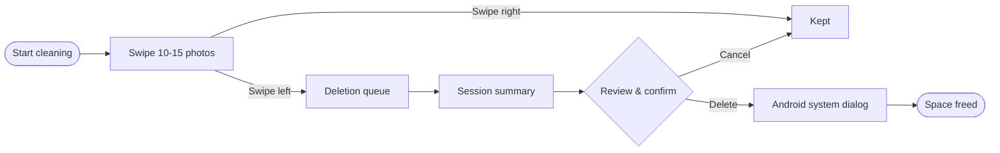

<div align="center">

# SwipeClean

### Swipe your gallery clean.

A Tinder-style photo cleaner for Android that turns a boring chore into a quick, satisfying game.
**Swipe left to delete, swipe right to keep.** Nothing is deleted until you say so, twice.

<br>

[](https://github.com/tamimrijan/SwipeClean/raw/main/release/SwipeClean-1.0.0.apk)


<br>


&nbsp;&nbsp;

&nbsp;&nbsp;


</div>

---

## Why SwipeClean?

Your gallery has thousands of photos: blurry shots, duplicates, old screenshots and memes.
Scrolling through all of them is exhausting, so nobody does it.

SwipeClean hands you **10–15 random photos at a time** on big full-screen cards. Swipe through them
in under a minute, while you're bored, in bed at night, or riding as a passenger, and watch your storage free up.

## How it works



> **You stay in control.** A left swipe only *queues* a photo. You can undo, review the selection,
> or cancel. Photos are deleted only after you confirm in the app **and** in Android's own dialog.

## Features

<table>
<tr>
<td width="50%" valign="top">

### Swipe to clean
- Large full-screen photo cards
- Rotation, KEEP / DELETE stamps and spring physics
- Haptic feedback and velocity flings
- Double-tap to keep, plus **Undo**
- Session counter and progress bar

</td>
<td width="50%" valign="top">

### Safe by design
- Temporary deletion queue that persists
- Summary showing kept, deleted and space to free
- Confirmation screen with previews
- **Delete / Review / Cancel** options
- Uses Android's official delete confirmation

</td>
</tr>
<tr>
<td width="50%" valign="top">

### Smart sessions
- Random picks that avoid recently shown photos
- Skip screenshots, downloads or favorites
- Exclude whole albums
- Adjustable session size (5–30)

</td>
<td width="50%" valign="top">

### Fun, not pushy
- Optional daily goal with a progress ring
- Day streaks and lifetime stats
- Confetti and friendly messages
- Keeping photos is celebrated too

</td>
</tr>
<tr>
<td width="50%" valign="top">

### Beautiful UI
- Material 3 design-kit styling
- Light, dark or system theme
- Optional Material You dynamic color
- Inter typeface, edge-to-edge layout

</td>
<td width="50%" valign="top">

### Private & light
- **No internet permission** at all
- Everything runs locally on your device
- No background services or tracking
- Full gallery browser with album filters

</td>
</tr>
</table>

## Download & install

1. Download **[SwipeClean-1.0.0.apk](https://github.com/tamimrijan/SwipeClean/raw/main/release/SwipeClean-1.0.0.apk)** on your phone.
2. Open it and allow **Install unknown apps** when Android asks.
3. Tap **Install**. If Play Protect warns about an unknown developer, choose **Install anyway**.

<details>
<summary><b>Install with USB (adb)</b></summary>

<br>

1. Enable **Developer options** (tap *Build number* 7 times in *About phone*), then turn on **USB debugging**.
2. Connect your phone and run:

```bash
adb install -r release/SwipeClean-1.0.0.apk
```

</details>

## Privacy

| | |
|---|---|
| Internet access | **None.** The app has no `INTERNET` permission. |
| Where data lives | Only on your device: settings, stats and history are stored locally. |
| Deletion | Only through Android's system-approved APIs. No root needed. |
| Background work | None. Photos are scanned only when you open the app. |

## Compatibility

| Android version | Photo access | How deletion is approved |
|---|---|---|
| 14+ | All photos, or **Select photos** (partial access) | System confirmation dialog |
| 13 | `READ_MEDIA_IMAGES` | System confirmation dialog |
| 11–12 | `READ_EXTERNAL_STORAGE` | System confirmation dialog |
| 10 | `READ_EXTERNAL_STORAGE` | System consent prompt |
| 8–9 | Storage permission | In-app confirmation |

Minimum **Android 8.0** (API 26) · Target **API 35**

## Build from source

<details>
<summary><b>Android Studio (easiest)</b></summary>

<br>

1. Install **Android Studio** (Ladybug 2024.2 or newer).
2. **File → Open** and select the project folder.
3. Wait for Gradle sync, then press **Run ▶**.

</details>

<details>
<summary><b>Command line</b></summary>

<br>

You'll need **JDK 17** and the **Android SDK** (platform 35).

```bash
git clone https://github.com/tamimrijan/SwipeClean.git
cd SwipeClean
./gradlew assembleRelease      # Windows: .\gradlew.bat assembleRelease
```

The APK is copied to `release/SwipeClean-<version>.apk` automatically.

> The release build is signed with the debug key so it installs for testing.
> Use your own keystore before publishing to Google Play.

</details>

<details>
<summary><b>Project structure</b></summary>

<br>

```
app/src/main/java/com/swipeclean/app/
├── MainActivity.kt              Edge-to-edge entry point
├── data/
│   ├── Photo.kt                 Photo & Album models
│   ├── PhotoRepository.kt       MediaStore queries + version-specific deletion
│   ├── Permissions.kt           Per-version permission logic
│   ├── Prefs.kt                 Settings, stats, streaks, queue, history
│   └── SessionPicker.kt         Random, filtered, no-repeat selection
└── ui/
    ├── App.kt                   Permission gate, navigation, system dialogs
    ├── AppViewModel.kt          Session, queue, deletion flow and stats
    ├── theme/Theme.kt           Material 3 colors + Inter typography
    ├── components/Common.kt     Shared UI pieces and confetti
    └── screens/                 Home, Swipe, Summary, Confirm, Gallery, Settings...
```

</details>

## Built with


Kotlin 2.0 · Jetpack Compose (Material 3) · MediaStore API · Coil · Gradle 8.11 ·
[Inter](https://rsms.me/inter/) typeface (SIL Open Font License)

---

<div align="center">

### Made by Tamim Ahmed Rijan

[](https://github.com/tamimrijan)
[](https://www.instagram.com/tamim_ahmed_rijan/)

If SwipeClean helped you free up some space, consider giving it a ⭐

</div>
